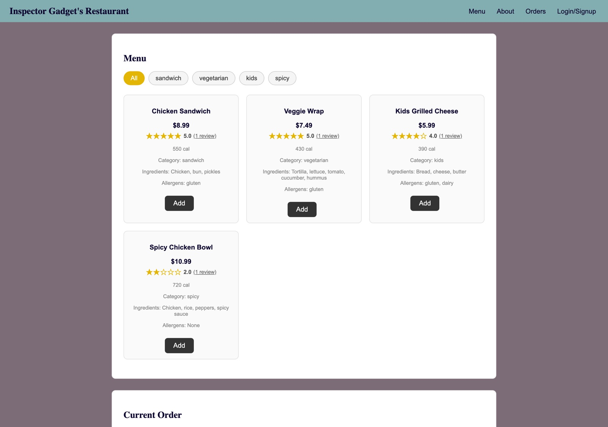
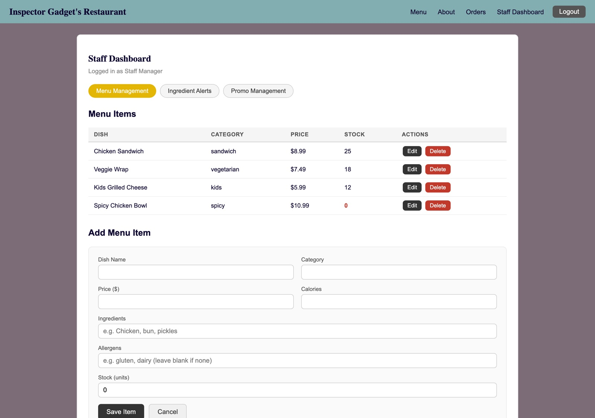
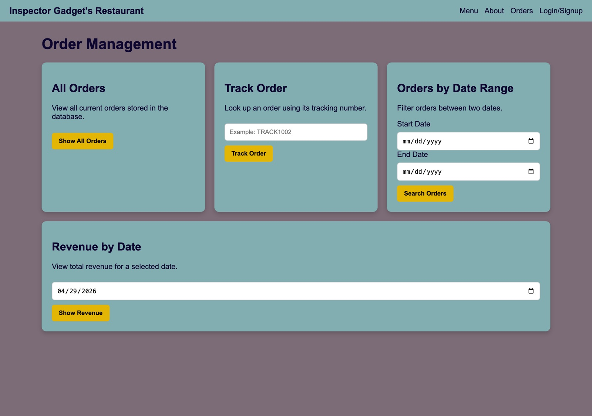
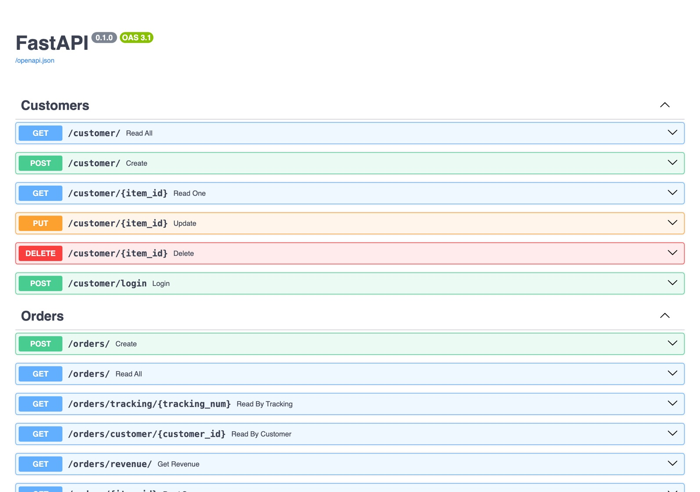
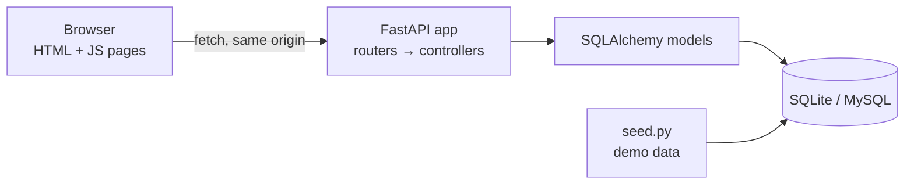

# Restaurant Order System

A full-stack restaurant ordering app: customers browse a menu, apply promo codes, place orders and review dishes, while staff manage the menu, inventory and promotions. It's built with a **FastAPI + SQLAlchemy** REST API and a framework-free **HTML/CSS/JavaScript** frontend.

[](https://restaurant-order-system-vwif.onrender.com/)
[](https://restaurant-order-system-vwif.onrender.com/docs)


> **Try it:** [restaurant-order-system-vwif.onrender.com](https://restaurant-order-system-vwif.onrender.com/)
> It runs on Render's free tier, so the first load after it has been idle can take up to a minute. Demo data resets whenever the server restarts.

| Role | Email | Password |
|---|---|---|
| Customer | `alice.johnson@email.com` | `password123` |
| Staff | `staff@restaurant.com` | `staffpass123` |



## Features

**Customers**
- Browse the menu with category filters, calories, allergens and star ratings
- Build an order, apply a promo code (validated server-side, including expiry) and check out
- Create an account and log in
- Rate and review dishes they have ordered

**Staff**
- Staff-only dashboard for creating, editing and deleting menu items
- Stock tracking that decreases as orders come in, with alerts for items that are low (under 5) or out of stock
- Promotion management with expiration dates

**Orders**
- View all orders, look one up by tracking number, or filter by date range
- Revenue total for any given day

**API**
- 39 REST endpoints across customers, orders, menu items, payments, promotions and reviews
- Interactive OpenAPI docs at [`/docs`](https://restaurant-order-system-vwif.onrender.com/docs)

## Screenshots

| Staff dashboard | Order management |
|---|---|
|  |  |

| Interactive API docs |
|---|
|  |

There's also a [demo video](docs/demo-video.mp4) from the original project presentation.

## Tech stack

| Layer | Tools |
|---|---|
| Backend | Python, FastAPI, Pydantic, SQLAlchemy ORM, Uvicorn |
| Database | SQLite for the hosted demo; MySQL supported through configuration |
| Frontend | HTML, CSS, vanilla JavaScript (Fetch API), served by FastAPI |
| Testing | pytest, pytest-mock, FastAPI TestClient |
| Deployment | Render (Blueprint in `render.yaml`), settings from environment variables |

## Architecture



The API follows a layered structure: **routers** define endpoints, **controllers** hold the business logic, **schemas** (Pydantic) validate requests and responses, and **models** (SQLAlchemy) map to database tables. FastAPI also serves the frontend pages, so the whole app runs as one service at one URL.

## My role

I was the team's Scrum Master and worked across the stack. My main contributions:

- Set up the frontend page structure and reworked the styling across all pages
- Built customer account creation and login, then the staff account type and staff-only dashboard
- Built the order management and staff pages, including filtering orders by date range
- Added dish reviews and ratings, and made them visible on the menu
- Made inventory stock decrease when items are ordered
- Wrote the seed script for demo data
- Prepared the app for hosting: environment-based configuration, SQLite support, serving the frontend from FastAPI, and the Render deployment

## Run locally

Requires Python 3.11 or newer.

```bash
git clone https://github.com/Andydchoo/Restaurant-Order-System.git
cd Restaurant-Order-System
python -m venv .venv && source .venv/bin/activate
pip install -r requirements.txt
SEED_ON_STARTUP=true uvicorn api.main:app --reload
```

Then open [http://127.0.0.1:8000](http://127.0.0.1:8000) for the app and [http://127.0.0.1:8000/docs](http://127.0.0.1:8000/docs) for the API docs.

### Configuration

| Variable | Purpose | Default |
|---|---|---|
| `DATABASE_URL` | Any SQLAlchemy database URL | `sqlite:///./restaurant.db` |
| `DB_HOST`, `DB_PORT`, `DB_USER`, `DB_PASSWORD`, `DB_NAME` | Build a MySQL URL instead of setting `DATABASE_URL` | not set |
| `SEED_ON_STARTUP` | Reset to demo data every time the server starts | `false` |

Leave out `SEED_ON_STARTUP` to keep your data between restarts, or run `python seed.py` to reset it by hand.

### Tests

```bash
pytest
```

## Project structure

```text
api/
├── main.py           # App setup, routes, and frontend static files
├── routers/          # Endpoint definitions
├── controllers/      # Business logic
├── models/           # SQLAlchemy tables
├── schemas/          # Pydantic request/response models
├── dependencies/     # Settings and database session
└── tests/            # pytest suite
menu_template/        # Customer menu and checkout
login_template/       # Sign up and log in
orders_template/      # Order tracking, date-range search, revenue
staff_template/       # Staff dashboard
group_bio_template/   # Team page
seed.py               # Demo data
render.yaml           # Render deployment
```

## Deployment

`render.yaml` defines a free Render web service. In Render, choose **New → Blueprint** and connect this repository. Render installs the requirements, starts Uvicorn and reseeds the demo data on each boot.

## Known limitations and next steps

This started as a course project, and a few things would need to change before real use:

- **Authentication:** logins aren't backed by sessions or tokens, and the staff page is protected only in the browser. Next step: JWT or session auth with role checks on the staff API endpoints.
- **Password storage:** passwords use unsalted SHA-256. Next step: bcrypt or Argon2.
- **Payments:** card details are simulated text. A real version would hand payments to a provider such as Stripe.
- **Persistence:** the hosted demo uses a SQLite file that resets on restart, by design. A production setup would use a managed database with migrations (Alembic).

## Team

Built for ITSC 3155 (Software Engineering) at UNC Charlotte by Nate Gustafson, Andy Choo, Jeevan Liu, Caimen French and Andy Nguyen. Original team repository: [illcommittee/ITSC3155-FinalProject](https://github.com/illcommittee/ITSC3155-FinalProject).
